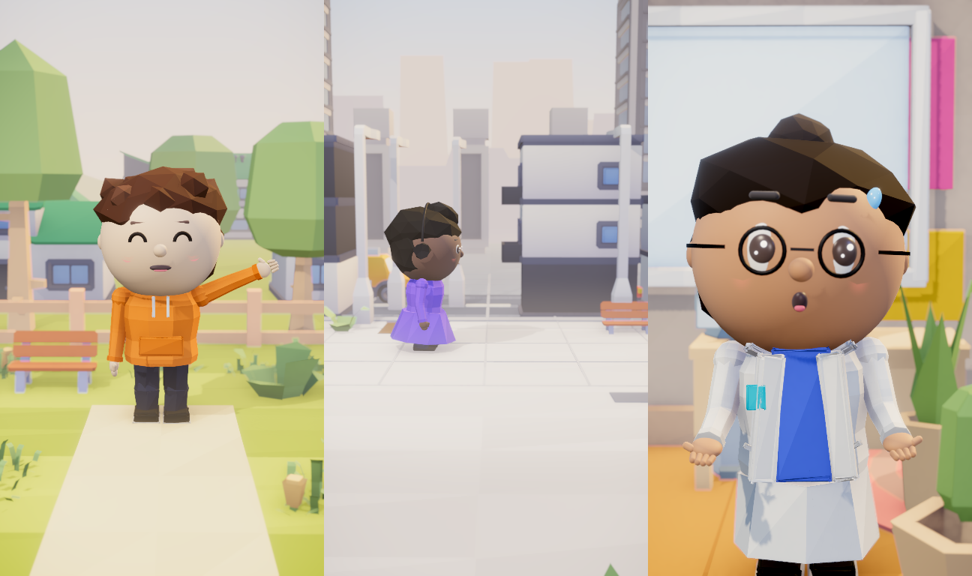
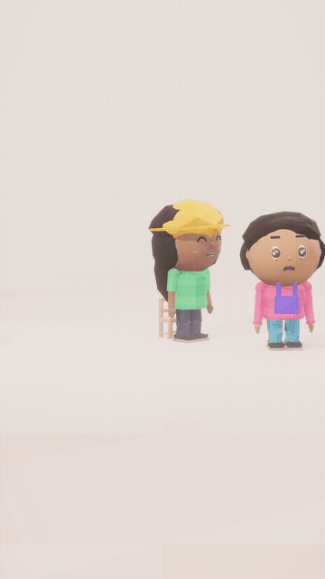
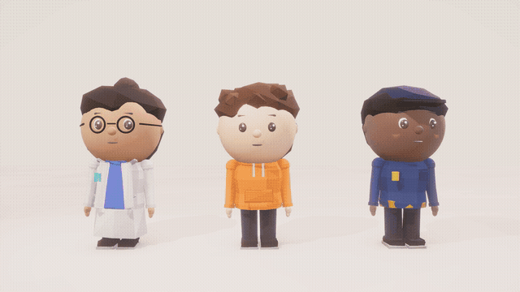

# lowpoly-kit

**Code-generated 3D low-poly characters, motion and sets for vertical videos.**
Built on [Remotion](https://www.remotion.dev) + [react-three-fiber](https://r3f.docs.pmnd.rs). Every frame is a pure function of the frame number, so renders are deterministic and everything is editable as code: no Blender, no keyframing UI.

<p align="center"></p>
<p align="center">
  
  
</p>

## What's inside

| Part | What it does | Where |
|---|---|---|
| Characters | Chibi people from a small spec: 15 hair styles, 14 outfits, hats, glasses, eyes, brows, mouths, mitten hands, tube arms, knees | `src/kit/character/Person.tsx`, `types.ts`, `examples.ts` |
| Acting | 13 named expressions and 10 poses | `src/kit/character/acting.ts` |
| Motion | Keyed poses and expressions, springs, idle life (weight shifts, eye darts, blinks), head follow-through | `src/kit/character/motion.ts` |
| Gestures | 21 gestures with anticipation / hit / hold / release: wave, nod, shake, shrug, point, thumbsUp, facepalm, cheer, crossArms, thinkChin, clap, typing, phoneLook, presentLeft/Right, gasp, lean, headScratch, fistPump, beat, hop | `src/kit/character/gestures.ts` |
| Locomotion | Walk and run along a path with no foot sliding, turn on arrival, crouch, sit on chairs | `walkAt`, `sitPose` in `motion.ts` |
| Shots | Three-layer vertical shots (blurred foreground, subject on dressed ground, ordered background) from a recipe + setting | `src/kit/scene/ShotScene.tsx` |
| Sets | suburb, downtown, airfield, office, newsroom, home | `src/kit/scene/settings.ts` |
| Lighting | Daylight and mood presets (sunnyDay, peachMorning, softOvercast, candyDusk, blueHour, …) with fog, bloom, depth of field | `src/kit/lighting.tsx` |
| Props | 1,867 Kenney CC0 models, auto-recoloured to the palette | `src/kit/props/Asset.tsx`, `docs/asset-library.md` |
| Extras | Captions, info cards, thumbnail type, edge styles | `src/kit/Captions.tsx`, `src/kit/cards/` |

## Quick start

```bash
git clone https://github.com/TachiBae/lowpoly-kit.git
cd lowpoly-kit
npm ci
npm run dev        # opens Remotion Studio: browse the Labs and ExampleShort
npm run example    # renders out/example.mp4
```

Requires Node 18+. Rendering uses Chrome's GPU (`--gl=angle`); on Linux servers without a GPU use `--gl=swangle`.

## Use it with Claude Code

The repo is also a Claude Code plugin. Its `lowpoly-kit` skill points Claude at the kit's docs, components and rules, so you can ask for shots in plain words.

In Claude Code, run:

```
/plugin marketplace add TachiBae/lowpoly-kit
/plugin install lowpoly-kit@lowpoly-kit
```

Restart Claude Code (or run `/reload-plugins`), open your clone of the kit, and ask, for example: *"Make a 2-second medium shot in the office where the scientist gasps."* The skill loads by itself; you can also call it with `/lowpoly-kit:lowpoly-kit`.

To update later: `/plugin marketplace update lowpoly-kit`.

Without the plugin system, copy the skill folder instead: `cp -r skills/lowpoly-kit ~/.claude/skills/`.

## Your first shot

```tsx
import {ShotScene} from './kit/scene/ShotScene';
import {Person} from './kit/character/Person';
import {expressions} from './kit/character/acting';
import type {PersonSpec} from './kit/character/types';

const me: PersonSpec = {
  name: 'me',
  skin: '#F6D3B3',
  hair: {style: 'curly', color: '#5A3220'},
  outfit: {style: 'hoodie', main: '#FF8A3D', inner: '#222', pants: '#30364A'},
};

export const MyShot = () => (
  <ShotScene recipe="medium" setting="suburb" duration={60}>
    <Person
      spec={me}
      expression={expressions.happy}
      act={{
        idle: 'calm',
        walk: {from: [-1.5, 0, 0], to: [0, 0, 0], start: 0, faceAfter: 0},
        gestures: [{g: 'wave', at: 40}],
      }}
    />
  </ShotScene>
);
```

Register it in `src/Root.tsx` with `withLook(MyShot, 'v2')` (see `ExampleShort` there), then `npm run dev`.

- **Recipes:** `closeUp`, `medium`, `wide`, `overShoulder`, `lowHero`, `insert`.
- **One action per shot:** shots in Shorts last 1–2 s, so give each character one gesture or walk that lands at 20–40% of the shot.
- **Determinism:** never use `Math.random()` or `useFrame`; use the seeded helpers (`lcg`, `seed` props).

## Labs (live demos in Remotion Studio)

| Composition | Shows |
|---|---|
| `ActLab` | idle levels (calm / alert / nervous), then walk-in + wave, run, hop, sit |
| `GestureLab` | every gesture, three at a time |
| `GestureReel` | every gesture, one at a time, vertical (the README GIF) |
| `GestureCheck` | gestures frozen at their hold frame from three angles |
| `DaylightLab2` | reference framings for each shot recipe |
| `SetLab`, `PresetLab`, `EdgeLab` | settings, lighting presets, edge styles |
| `ArmLab`, `BodyLab`, `HandLab` | character build details |
| `CastTurnaround`, `CastExpressions` | character sheets (1920×1080) |

## Docs

- `docs/style-bible.md`: the look (palette, materials, lighting, camera).
- `docs/kit-catalog.md`: every component and helper.
- `docs/qa-checklist.md`: what to check before publishing a video.
- `docs/asset-library.md`: all Kenney model ids.

## Tools

- `npm run stills -- <CompositionId> <outDir> <frames...>`: render a few stills fast (one browser, one bundle).
- `npm run check`: type check + motion and foot-slide unit checks.
- `tools/bake-kenney.py`: bakes textures of new Kenney models into vertex colours (textured GLBs can stall headless renders).

## Roadmap

- Lip-sync from word timings (talking characters), listener reactions
- Gaze (`lookAt`), reaction pops, double-takes
- `Performer` wrapper with acting presets (explainer, skeptic, hype, worried, reveal)
- Coats and dresses that move with the legs, turn-in-place steps

## Credits and license

- Code: [MIT](LICENSE) © 2026 Jorel.
- 3D models in `public/kenney/`: [Kenney](https://www.kenney.nl), CC0 1.0 (textures baked to vertex colours).
- Font: Inter (SIL Open Font License 1.1, see `public/fonts/OFL.txt`).
- Made for the YouTube Shorts channel [Hold on, Why?](https://www.youtube.com/@holdonwhystudio).
